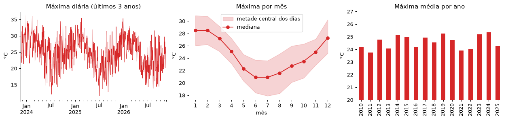
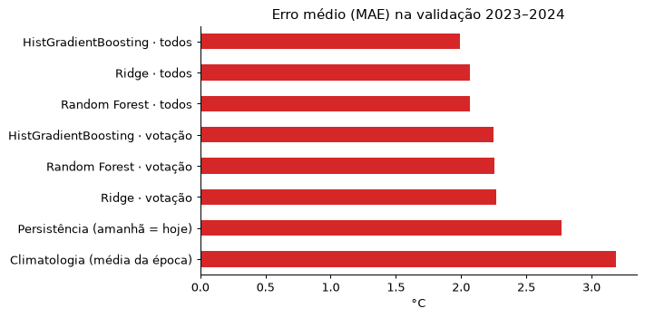
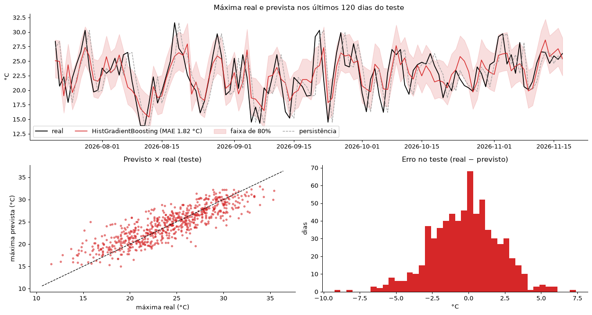
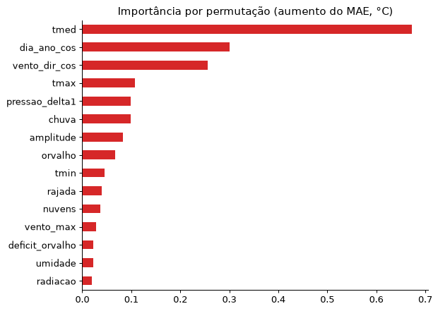

# 🌡️ Temperatura máxima do dia seguinte em Jaraguá do Sul com Aprendizagem de Máquina

Projeto N3 da disciplina de **Aprendizagem de Máquina**, Católica de Santa Catarina, 8º semestre.

**Integrantes:** Felipe Bogo, Jeison Diniz, Thierry Busnardo e André Ramos.

Um modelo de regressão usa as condições do tempo de **hoje** e dos últimos dias para prever a **temperatura máxima de amanhã**
(°C) em Jaraguá do Sul (SC). A solução vai da coleta dos dados até uma demonstração: um script e uma interface web que mostram a
máxima prevista, uma faixa provável e o porquê da previsão, além de um simulador "e se...?".

O projeto aprofunda a aplicação desenvolvida na disciplina de Análise Preditiva
([n3-mlops-temperatura-jaragua](https://github.com/zanelladev/n3-mlops-temperatura-jaragua)), agora com foco no processo
de aprendizagem de máquina: exploração, seleção de atributos, comparação de algoritmos, avaliação e análise de erros.

## Sumário

1. [Introdução](#1-introdução)
2. [Dados](#2-dados)
3. [Conceitos utilizados](#3-conceitos-utilizados)
4. [Organização do projeto](#4-organização-do-projeto)
5. [Como executar](#5-como-executar)
6. [Preparação e modelagem](#6-preparação-e-modelagem)
7. [Resultados](#7-resultados)
8. [Demonstração de uso](#8-demonstração-de-uso)
9. [Considerações finais](#9-considerações-finais)
10. [Referências](#10-referências)

## 1. Introdução

Jaraguá do Sul fica no Vale do Itapocu, no norte de Santa Catarina, com verões quentes e úmidos (máxima mediana de 28,5 °C em
janeiro e fevereiro) e invernos amenos (20,9 °C em junho e julho). A passagem de **frentes frias** pode derrubar a máxima em mais de 5 °C de um dia para o outro, e
ondas de calor elevam as máximas acima de 35 °C. Saber com antecedência a máxima do dia seguinte ajuda a planejar várias atividades.

**Objetivo:** construir um modelo que, ao fim de cada dia, preveja a temperatura máxima de amanhã, com uma faixa de incerteza
e uma explicação simples, usando só dados meteorológicos públicos.

**Quem poderia usar:**

| Usuário | Para quê |
|:--|:--|
| Produtores rurais | proteger animais e lavouras do estresse térmico, escolher o horário de pulverização |
| Defesa Civil e Secretaria de Saúde | alertas de calor para idosos e crianças, planejamento de atendimento |
| Escolas e empresas | atividades ao ar livre, climatização, escalas de trabalho externo |
| Comércio e indústria | demanda de bebidas, ventiladores e energia |
| População | planejar o dia seguinte |

**Pergunta de ML:** é uma **regressão**. Cada dia *t* é uma amostra; a entrada são as variáveis de *t* e dos dias anteriores,
e o alvo é a temperatura máxima de *t+1*.

## 2. Dados

- **Fonte:** [Open-Meteo Historical Weather API](https://open-meteo.com/en/docs/historical-weather-api)
  (`archive-api.open-meteo.com/v1/archive`), reanálise **ERA5** do Copernicus Climate Change Service (licença **CC BY 4.0**).
- **Local:** ponto de grade -26,49; -49,07 (Jaraguá do Sul).
- **Período:** 01/01/2010 a 17/11/2026, **6.165 dias**, um registro por dia. O ERA5 é publicado com cerca de 6 dias de atraso.
- **Arquivo:** [`data/raw/jaragua_diario.csv`](data/raw/jaragua_diario.csv), baixado com `python -m src.dados`.
- **Variáveis (14):** temperaturas máxima, mínima e média; umidade relativa; ponto de orvalho; pressão ao nível do mar;
  cobertura de nuvens; vento máximo, rajada e direção dominante; chuva acumulada; horas de chuva; radiação solar;
  evapotranspiração. O dicionário completo está no [notebook 01](notebooks/01_exploracao_dados.ipynb).
- **Demonstração:** os dados de hoje vêm da [API de previsão do Open-Meteo](https://open-meteo.com/en/docs), que não tem o
  atraso do ERA5.

## 3. Conceitos utilizados

- **Aprendizado supervisionado e regressão:** o modelo aprende com exemplos rotulados (a máxima que de fato ocorreu no dia seguinte).
- **Engenharia de atributos para séries temporais:** *lags* (máxima de 1, 2 e 3 dias atrás), médias móveis (3 e 7 dias),
  diferenças (variação da máxima, da pressão e da umidade), amplitude térmica e codificação **cíclica** (seno e cosseno) do
  dia do ano e da direção do vento.
- **Vazamento de dados (*data leakage*):** todos os atributos olham só para o passado; um teste automatizado garante isso.
- **Seleção de atributos por votação:**
  - **SelectKBest** (teste F): relação linear de cada atributo com o alvo;
  - **Random Forest:** importância num modelo não linear;
  - **RFE** (eliminação recursiva) com Ridge.

  Entra o atributo com voto da maioria (2 de 3).
- **Validação temporal:** treino, validação e teste em ordem cronológica e `TimeSeriesSplit` na busca de hiperparâmetros
  (`GridSearchCV`). Uma divisão aleatória colocaria dias vizinhos (quase iguais) em treino e teste e daria um resultado otimista.
- **Modelos:**
  - **Ridge:** regressão linear com regularização L2.
  - **Random Forest:** *bagging* de árvores de decisão.
  - **HistGradientBoosting:** *boosting* de árvores, em que cada árvore corrige os erros das anteriores.
- **Referências ingênuas (*baselines*):**
  - **persistência:** amanhã repete hoje;
  - **climatologia:** a máxima média daquela época do ano.

  Um modelo só tem valor se as superar.
- **Métricas:**
  - **MAE:** erro médio em °C, a métrica principal.
  - **RMSE:** penaliza mais os erros grandes.
  - **R²:** fração da variação explicada.
  - **% de dias com erro ≤ 2 °C** e **erro máximo**.
- **Faixa de incerteza empírica:** os percentis 10 e 90 dos resíduos na validação viram uma faixa de 80% em torno da previsão.
- **Interpretabilidade:** *permutation importance*.
- **Pipeline do scikit-learn:** imputação e escala são ajustadas só com o treino e vão junto no modelo salvo.

## 4. Organização do projeto

```
├── data/
│   ├── raw/jaragua_diario.csv     série diária 2010–2026 (ERA5 via Open-Meteo)
│   └── exemplo_entrada.csv        14 dias reais, para a demonstração funcionar sem internet
├── notebooks/
│   ├── 01_exploracao_dados.ipynb  problema, qualidade dos dados, exploração e tratamentos
│   ├── 02_modelagem.ipynb         baselines, votação de atributos, busca de hiperparâmetros, escolha e treino final
│   └── 03_avaliacao.ipynb         teste, gráficos, análise de erros, importância dos atributos e limitações
├── src/
│   ├── config.py                  local, variáveis, datas da divisão, parâmetros da votação
│   ├── dados.py                   coleta no Open-Meteo (histórico e dias recentes)
│   ├── features.py                diagnóstico, limpeza, atributos e divisão temporal
│   ├── selecao.py                 três métodos de seleção e a votação por maioria
│   ├── modelagem.py               modelos, baselines, métricas e faixa de incerteza
│   └── previsao.py                uso do modelo salvo, com explicação em linguagem simples
├── models/modelo_tmax.joblib      modelo final (Pipeline + atributos + faixa de erro)
├── reports/                       métricas (JSON/CSV), votação e figuras geradas pelos notebooks
├── tests/test_projeto.py          testes automatizados (vazamento, divisão, votação, previsão)
├── prever.py                      demonstração por linha de comando
├── app.py                         demonstração com interface web (Streamlit)
└── .github/workflows/testes.yml   roda os testes a cada push
```

## 5. Como executar

Requer **Python 3.12**.

```bash
git clone https://github.com/Pelife12/n3-aprendizagem-maquina.git
cd n3-aprendizagem-maquina
python -m venv .venv
source .venv/bin/activate        # no Windows: .venv\Scripts\activate
pip install -r requirements.txt
```

**Usar o modelo já treinado (demonstração):**

```bash
python prever.py                                    # máxima de amanhã com os dados reais de hoje
python prever.py --arquivo data/exemplo_entrada.csv # sem internet
streamlit run app.py                                # interface web em http://localhost:8501
```

**Reproduzir tudo do zero:**

```bash
python -m src.dados                                 # (opcional) baixa a série atualizada
jupyter nbconvert --to notebook --execute --inplace notebooks/01_exploracao_dados.ipynb
jupyter nbconvert --to notebook --execute --inplace notebooks/02_modelagem.ipynb
jupyter nbconvert --to notebook --execute --inplace notebooks/03_avaliacao.ipynb
python -m pytest -q
```

Os notebooks também podem ser abertos com `jupyter lab` e executados célula a célula. A semente é fixa (`42`), então os
resultados se repetem.

## 6. Preparação e modelagem

**Exploração e tratamentos** ([notebook 01](notebooks/01_exploracao_dados.ipynb)):

- **Qualidade:** o ERA5 não tem dias faltando, duplicados nem valores impossíveis. Mesmo assim, o pipeline completa o
  calendário e transforma valores fora da faixa física em ausentes, imputados pela mediana do treino. Assim ele fica robusto
  aos dados da API de previsão usados na demonstração.
- **Outliers estatísticos** aparecem quase só na chuva e no vento. São eventos reais (temporais, frentes frias) e **não são
  removidos**.
- **Alvo:** a máxima média é 24,6 °C, variando de 9,7 a 37,3 °C, com ciclo sazonal forte.
- **Variação diária:** de um dia para o outro a máxima muda em média 2,6 °C. Quedas de mais de 5 °C (8,5% dos dias, frentes
  frias) são duas vezes mais comuns que altas de mais de 5 °C (4,2%).
- **Sinais de mudança:**
  - pressão caindo antecede queda da máxima, e pressão subindo antecede aquecimento;
  - um dia muito encoberto costuma ser seguido de máxima maior, porque o céu abre.



**Atributos candidatos (29):** as 13 variáveis do dia, mais:

- `tmax_lag1..3`, `tmax_media3`, `tmax_media7` e `tmax_delta`;
- amplitude térmica e variação da pressão em 1 e 2 dias;
- variação da umidade, chuva de 3 dias e `deficit_orvalho` (temperatura − ponto de orvalho);
- seno e cosseno da direção do vento e do dia do ano.

**Divisão temporal:**

| Conjunto | Período | Dias | Uso |
|:--|:--|--:|:--|
| Treino | 2010–2022 | 4.742 | votação de atributos, ajuste dos modelos e busca de hiperparâmetros (`TimeSeriesSplit`, 5 dobras) |
| Validação | 2023–2024 | 731 | escolha do algoritmo e do conjunto de atributos (menor MAE) e cálculo da faixa de erro |
| Teste | 01/2025–11/2026 | 685 | avaliação final, usada uma única vez |

**Votação de atributos:** os três métodos elegeram 7 atributos: `tmed`, `dia_ano_cos`, `tmin`, `vento_dir_cos`, `radiacao`,
`tmax` e `evapotranspiracao` ([tabela completa](reports/votacao_atributos.csv)). Cada algoritmo foi treinado duas vezes, com
todos os atributos e só com os eleitos.

**Comparação na validação** ([notebook 02](notebooks/02_modelagem.ipynb)):

| Modelo · atributos | MAE (°C) | RMSE (°C) | R² | Erro ≤ 2 °C |
|:--|--:|--:|--:|--:|
| **HistGradientBoosting · todos** | **1,989** | **2,600** | **0,666** | **61,0%** |
| Ridge · todos | 2,069 | 2,657 | 0,651 | 57,2% |
| Random Forest · todos | 2,070 | 2,679 | 0,646 | 58,7% |
| HistGradientBoosting · votação | 2,252 | 2,891 | 0,587 | 54,4% |
| Random Forest · votação | 2,254 | 2,879 | 0,591 | 54,3% |
| Ridge · votação | 2,268 | 2,882 | 0,590 | 52,9% |
| Persistência (amanhã = hoje) | 2,769 | 3,656 | 0,340 | 48,6% |
| Climatologia (média da época) | 3,188 | 3,945 | 0,232 | 36,7% |



**O que a comparação mostrou:**

- **Votação de atributos:** o conjunto enxuto deixou os modelos mais simples, mas **aumentou o erro em todos os algoritmos**
  (+0,2 a 0,3 °C). Os atributos descartados (variação da pressão, médias recentes, nuvens) ajudam justamente nos dias de mudança
  de tempo. A seleção foi testada e rejeitada com base na validação.
- **Modelo escolhido:** **HistGradientBoosting com todos os atributos** (learning rate 0,03, 15 folhas por árvore). Ele erra
  28% menos que a persistência.
- **Faixa de 80%:** de −2,9 °C a +3,6 °C em torno da previsão.
- **Treino final:** o modelo foi **retreinado com treino + validação** (2010–2024), para aproveitar os anos mais recentes.

## 7. Resultados

Os resultados abaixo são do **teste**: 685 dias de 2025 e 2026 que o modelo nunca viu ([notebook 03](notebooks/03_avaliacao.ipynb)).

| Modelo | MAE (°C) | RMSE (°C) | R² | Erro ≤ 2 °C | Erro máximo (°C) |
|:--|--:|--:|--:|--:|--:|
| Persistência (amanhã = hoje) | 2,45 | 3,22 | 0,49 | 52,5% | 16,2 |
| Climatologia (média da época) | 2,70 | 3,36 | 0,44 | 44,5% | 10,5 |
| **HistGradientBoosting** | **1,82** | **2,33** | **0,73** | **61,3%** | **9,2** |



**Interpretação:**

- **Erro médio:** o modelo erra em média **1,8 °C**, 26% menos que a persistência e 33% menos que a climatologia. Ele explica
  73% da variação da máxima.
- **Faixa de 80%:** a máxima real caiu dentro da faixa em **85%** dos dias do teste. A faixa é um pouco conservadora, o que é
  aceitável para quem usa a previsão.
- **Onde o modelo ganha e onde erra:**

  | Mudança real da máxima (hoje → amanhã) | Dias | MAE do modelo | MAE da persistência |
  |:--|--:|--:|--:|
  | queda de mais de 5 °C | 50 | 3,5 °C | 7,1 °C |
  | queda de 2 a 5 °C | 107 | 2,3 °C | 3,3 °C |
  | estável (±2 °C) | 355 | 1,4 °C | 1,0 °C |
  | alta de 2 a 5 °C | 150 | 1,8 °C | 3,2 °C |
  | alta de mais de 5 °C | 23 | 3,5 °C | 6,3 °C |

- **Ganho nas mudanças de tempo:** nas mudanças bruscas (frentes frias e retorno do calor) o modelo erra cerca de **metade**
  do que erra a persistência. Esses ainda são os seus maiores erros.
- **Dias estáveis:** quando nada muda, "amanhã = hoje" é quase perfeito e erra um pouco menos que o modelo.
- **O que mais pesa** (*permutation importance*):
  - a temperatura média de hoje;
  - a época do ano;
  - a direção do vento (de norte, mais quente);
  - a máxima de hoje, a variação da pressão e a chuva.



**Limitações:**

- **Reanálise não é estação:** o ERA5 representa uma célula de ~30 km e suaviza extremos locais. A métrica mede o quanto o
  modelo reproduz o ERA5, não um termômetro no centro da cidade.
- **Um ponto e dados diários:** o modelo não tem informação de cidades vizinhas (de onde vem a frente fria), de altitude nem de
  satélite. **Não substitui a previsão oficial**; é uma estimativa rápida, barata e explicável.
- **Mudanças bruscas** continuam sendo o ponto fraco.
- **Clima muda:** o modelo deve ser retreinado periodicamente com os dados novos.
- **Dados da demonstração:** os dados de hoje vêm da API de previsão, cuja distribuição é próxima, mas não idêntica, à do ERA5.

## 8. Demonstração de uso

**Linha de comando:** a entrada é a semana mais recente, e a saída é uma resposta em linguagem simples.

```text
$ python prever.py
Buscando os últimos dias na API do Open-Meteo...
Previsão para 25/11/2026 em Jaraguá do Sul (SC) (com os dados de 24/11/2026)
  Máxima prevista: 25.6 °C
  Faixa provável (8 em cada 10 dias): 22.7 a 29.2 °C
  Por quê:
    • máxima de hoje: 30.6 °C (média dos últimos 7 dias: 29.5 °C)
    • choveu 11 mm hoje
    • o modelo espera resfriamento de 5.0 °C
  (modelo HistGradientBoosting treinado até 2024-12-31)
```

O cenário pode ser alterado: `python prever.py --arquivo data/exemplo_entrada.csv --tmax-hoje 33 --nuvens 10`.

**Interface web** (`streamlit run app.py`), com três abas:

1. **Previsão de hoje:** usa os dados reais do dia (API do Open-Meteo).
2. **Simulador "e se...?":** controles para máxima e mínima de hoje, variação da pressão, nuvens, direção do vento e mês.
   A previsão muda na hora.
3. **Sobre o modelo:** métricas do teste e gráficos.

**Em Python:**

```python
import pandas as pd
from src import previsao

dias = pd.read_csv("data/exemplo_entrada.csv", parse_dates=["data"])   # >= 7 dias seguidos
print(previsao.texto(previsao.prever(dias)))
```

## 9. Considerações finais

- Com 15 anos de dados públicos e atributos simples, um modelo de *gradient boosting* prevê a máxima do dia seguinte em
  Jaraguá do Sul com **erro médio de 1,8 °C** em dados nunca vistos. Isso é 26% melhor que a persistência, com R² de 0,73.
- O ganho se concentra nos dias de **mudança de tempo**, os mais úteis para quem planeja o dia seguinte.
- **Os cuidados de avaliação importaram tanto quanto o algoritmo:**
  - a divisão cronológica;
  - os atributos que não olham o futuro;
  - as referências ingênuas;
  - as escolhas feitas só na validação;
  - o teste usado uma única vez.

  Sem isso, o resultado seria otimista.
- **A seleção de atributos por votação** não melhorou o modelo neste problema. Mostrar isso com números também é resultado:
  menos atributos nem sempre é melhor quando os "redundantes" carregam a informação de mudança de tempo.
- **Os três algoritmos ficaram próximos:** MAE de 1,99 a 2,07 °C na validação. Isso indica que o ganho principal veio dos
  atributos, e não da complexidade do modelo.
- **A faixa de incerteza** e a explicação em linguagem simples tornam a saída utilizável por quem não é da área.

**Trabalhos futuros:**

- incluir dados de cidades vizinhas e de níveis altos da atmosfera;
- prever também a mínima e a chance de chuva;
- comparar com a previsão numérica oficial;
- validar com estações locais (INMET/EPAGRI);
- automatizar o retreino periódico, como no projeto de MLOps que deu origem a este.

## 10. Referências

- ZIPPENFENIG, P. **Open-Meteo.com Weather API**. Zenodo, 2023. DOI: 10.5281/zenodo.7970649. Disponível em: https://open-meteo.com.
- HERSBACH, H. et al. **The ERA5 global reanalysis**. *Quarterly Journal of the Royal Meteorological Society*, v. 146, n. 730,
  p. 1999–2049, 2020. DOI: 10.1002/qj.3803.
- PEDREGOSA, F. et al. **Scikit-learn: Machine Learning in Python**. *Journal of Machine Learning Research*, v. 12,
  p. 2825–2830, 2011.
- KE, G. et al. **LightGBM: A Highly Efficient Gradient Boosting Decision Tree**. In: *Advances in Neural Information Processing
  Systems 30*, 2017. (base do `HistGradientBoostingRegressor`)
- BREIMAN, L. **Random Forests**. *Machine Learning*, v. 45, p. 5–32, 2001.
- GUYON, I.; ELISSEEFF, A. **An Introduction to Variable and Feature Selection**. *Journal of Machine Learning Research*, v. 3,
  p. 1157–1182, 2003.
- HYNDMAN, R. J.; ATHANASOPOULOS, G. **Forecasting: Principles and Practice**. 3. ed. OTexts, 2021. Disponível em: https://otexts.com/fpp3/.
- GÉRON, A. **Mãos à Obra: Aprendizado de Máquina com Scikit-Learn, Keras & TensorFlow**. 2. ed. Alta Books, 2021.
- INMET – Instituto Nacional de Meteorologia. **Normais Climatológicas do Brasil 1991–2020**. Brasília: INMET, 2022.

Dados meteorológicos: [Open-Meteo.com](https://open-meteo.com/) (CC BY 4.0), a partir da reanálise ERA5 do Copernicus Climate Change Service.
